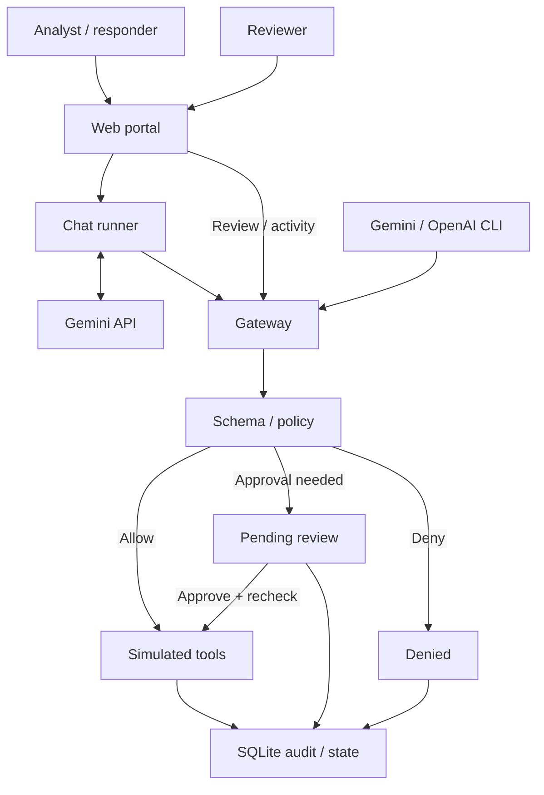

# AgentFence

**Policy-enforced tool execution for LLM agents.**

AgentFence sits between an LLM agent and its tools. It validates each proposed action, checks permissions and resource scope, requires human approval for sensitive operations, and records the outcome in an audit trail.

The repository includes a FastAPI gateway, a browser workspace, and bounded Gemini and OpenAI agent clients. Built-in tools operate on simulated incident-response resources, making it possible to exercise authorization and approval workflows without modifying real infrastructure.

## Capabilities

- **Strict request validation:** Typed tool schemas reject unknown fields, invalid identifiers, incorrect types, and unsupported tools.
- **Scoped authorization:** Decisions combine authenticated identity, role, assigned task, task intent, tenant, case, and resource ownership.
- **Human approval:** Sensitive requests pause for a separate reviewer. Approval is bound to the stored request digest, expires after five minutes, and rechecks policy before execution.
- **Transactional auditing:** SQLite stores request decisions and review events. Simulated mutations and their audit records commit together.
- **Context screening:** Pattern-based checks flag instruction overrides, credential disclosure attempts, and role impersonation in submitted context; suspicious read results are withheld.
- **Browser workspace:** Local password authentication, role-specific screens, prompt submission, approval review, and activity inspection.
- **Bounded agent execution:** Gemini and OpenAI clients submit proposals through the gateway, enforce turn limits, and stop on denial or pending approval.
- **Container separation:** Docker Compose separates the gateway, portal, and model runner with dedicated networks, read-only filesystems, dropped capabilities, and resource limits.

## Architecture



The model proposes actions; the gateway owns authorization and execution. The portal selects credentials from the authenticated session. The chat runner receives the current analyst or responder credential, never the reviewer credential, and has no gateway database mount.

## Quick start

### Browser workspace with Docker

Requirements:

- Git
- Docker Desktop running Linux containers, with Docker Compose
- Host Python 3.9 or newer for the setup scripts; containers use Python 3.12
- A Gemini API key and a model available to your account for browser chat

Run from PowerShell:

```powershell
git clone https://github.com/Bharatttt/agentfence.git
cd agentfence
py -3 scripts/setup.py
py -3 scripts/setup_ui.py
docker compose --profile ui up --build -d portal
docker compose ps
```

On macOS or Linux, use `python3` in place of `py -3`.

Setup creates local gateway credentials, asks for a distinct password of at least 12 characters for each account, and saves your Gemini configuration. Enter a model available to your account when prompted. Existing complete configuration is preserved.

Open **http://127.0.0.1:8001** and sign in with `analyst`, `responder`, or `reviewer` and the corresponding password you chose. Use this exact origin for the default configuration.

| Account | Permissions |
| --- | --- |
| `analyst` | Run investigation tasks and read authorized resources |
| `responder` | Read authorized resources and propose sensitive containment actions |
| `reviewer` | Review pending actions and inspect audit records; cannot run agent tasks |

For subsequent starts:

```powershell
docker compose --profile ui up -d portal
```

To stop the services while retaining the database volume:

```powershell
docker compose --profile ui down
```

### Try the workflow

1. Sign in as `analyst` and submit: **Read metadata for asset-1.**
2. Try: **Read metadata for asset-2.** If the model proposes the call, the gateway rejects the out-of-scope resource.
3. Sign in as `responder` and submit: **Disable key-1 for suspected compromise.**
4. Sign in as `reviewer` within five minutes, inspect the pending request, and approve or reject it.
5. Inspect Activity to see the recorded decision and audit events.

You can type your own prompts. Each submission starts an independent run with up to four model requests. Approval executes the stored action but does not resume the model conversation. Use separate browser profiles to keep requester and reviewer sessions open simultaneously.

A model refusal alone does not demonstrate a gateway block; inspect the recorded tool request and decision.

### Gateway console without an API key

After running `scripts/setup.py`:

```powershell
docker compose up --build -d gateway
```

Open **http://127.0.0.1:8000**. Read `runtime/credentials.json` locally and use the appropriate role token in the console. Its built-in scenarios submit structured requests directly, so no model provider is required.

### Native development

Use Python 3.12 for the application environment:

```powershell
py -3.12 -m venv .venv
.\.venv\Scripts\python.exe -m pip install -r requirements.txt
.\.venv\Scripts\python.exe scripts/setup.py
.\.venv\Scripts\python.exe -m uvicorn agentfence.app:create_app --factory --host 127.0.0.1 --port 8000 --no-access-log
```

The native gateway uses `runtime/state/agentfence.sqlite3`. Docker uses the `gateway-state` named volume; these are separate databases.

## Tool catalog

All tools require `tenant_id` and `case_id` and operate within the caller's assigned task.

| Tool | Purpose | Policy |
| --- | --- | --- |
| `get_asset_metadata` | Read asset details | Authorized analyst or responder |
| `search_incident_runbooks` | Search scoped documents with a bounded result limit | Authorized analyst or responder |
| `read_document` | Read a scoped document | Authorized analyst or responder; output screening applies |
| `disable_access_key` | Mark a simulated key as disabled | Responder, containment task, reviewer approval |
| `export_asset_report` | Record a simulated report export | Responder, containment task, destination `case-archive`, reviewer approval |

## API

Protected gateway endpoints require `Authorization: Bearer <token>`.

| Method | Endpoint | Purpose |
| --- | --- | --- |
| GET | `/health` | Service health; no authentication required |
| GET | `/api/me` | Authenticated identity and assigned tasks |
| POST | `/api/calls` | Submit a structured tool proposal |
| GET | `/api/requests` | List requests visible to the caller |
| POST | `/api/approvals/{request_id}` | Approve or reject a pending request as reviewer |
| GET | `/api/audit` | Retrieve audit events as reviewer |

Example proposal body:

```json
{
  "task_id": "investigation-1",
  "tool": "get_asset_metadata",
  "arguments": {
    "tenant_id": "tenant-a",
    "case_id": "case-1",
    "asset_id": "asset-1"
  }
}
```

Tool decisions are `allow`, `deny`, or `require_approval`. Review bodies contain `approve` and the exact `request_digest` returned for the pending request.

## Agent clients

The CLI clients share a gateway-only execution loop. Configure credentials locally before running a client:

| Client | Required environment variables | Compose profile / service |
| --- | --- | --- |
| Gemini | `GEMINI_API_KEY`, `GEMINI_MODEL`, `AGENTFENCE_TOKEN` | `gemini` / `gemini-agent` |
| OpenAI | `OPENAI_API_KEY`, `OPENAI_MODEL`, `AGENTFENCE_TOKEN` | `llm` / `llm-agent` |

For example, with the variables already configured and an analyst token:

```powershell
docker compose --profile gemini run --rm gemini-agent --prompt "Read metadata for asset-1."
```

Both clients accept `--prompt`, `--task` (default: `investigation-1`), and `--turns` (default: 4, maximum: 8). For containment requests, use the responder token with `--task response-1`. Provider access requires internet connectivity and available quota.

## Tests

From the native development environment:

```powershell
.\.venv\Scripts\python.exe -m pytest
.\.venv\Scripts\python.exe scripts/smoke.py
```

The suite covers schema validation, scope enforcement, task permissions, suspicious context, approval binding and expiry, replay and concurrent approval handling, audit rollback, agent turn limits, and portal authentication and request protections. Model integration tests use simulated provider responses and do not require API keys. The smoke script starts an isolated HTTP gateway and exercises a separate client process.

## Repository structure

| Path | Contents |
| --- | --- |
| `agentfence/` | Gateway API, schemas, policy checks, SQLite store, and technical console |
| `portal/` | Password authentication, browser backend, and workspace interface |
| `demo/` | Gemini and OpenAI clients, chat runner, and scripted replay |
| `scripts/` | Credential setup, workspace setup, and HTTP smoke test |
| `tests/` | Gateway, agent, provider-adapter, and portal tests |
| `compose.yaml` | Service configuration, networks, secrets, and persistent state |
| `Dockerfile*` | Gateway, agent, portal, and runner images |

## Security boundaries

AgentFence is a local security gateway implementation with simulated tools. It does not disable real cloud keys or transfer real reports.

- Enforcement depends on routing protected operations through the gateway. The host, portal, gateway code, and configuration are trusted.
- Context screening uses limited regular-expression rules. It is not comprehensive prompt-injection detection.
- Audit records are stored in SQLite and are not tamper-proof against host or database administrators.
- Model-enabled containers have outbound connectivity; the Compose configuration does not enforce destination-level egress filtering.
- The local portal uses password sessions without MFA, an external identity provider, or distributed session storage. Keep the default loopback bindings; remote deployment requires additional hardening.
- Keep `runtime/`, credentials, and provider keys private. Runtime files are excluded from Git and Docker build contexts.

## Future scope and enhancements

The following are proposed directions for future development, not capabilities available in the current implementation.

- **Real tool integrations:** Add adapters for cloud IAM, incident-response systems, and MCP tools, with explicit resource scopes, dry-run support, and narrowly scoped service credentials.
- **Configurable policies:** Introduce versioned policy configuration, policy validation, and regression checks so teams can manage authorization rules without changing gateway code.
- **Enterprise identity:** Integrate an external identity provider with SSO, MFA, short-lived credentials, and centralized session management.
- **Stronger isolation:** Enforce destination-level outbound network restrictions and isolate tool adapters to reduce the impact of a compromised model runner or integration.
- **Durable approval workflows:** Support notifications, configurable expiry, multiple reviewers for high-risk operations, and safe resumption of agent runs after approval while preserving request binding and replay protection.
- **Audit integrity and observability:** Add tamper-evident audit records, external log export, metrics, and tracing for decision latency, denials, approval turnaround, and execution failures.
- **Broader security evaluation:** Expand adversarial and concurrency tests, measure false positives and gateway overhead, and evaluate layered input and output screening against documented attack scenarios.
- **Deployment scalability:** Evaluate PostgreSQL, shared session storage, and multiple gateway workers with consistent approval and execution semantics.
