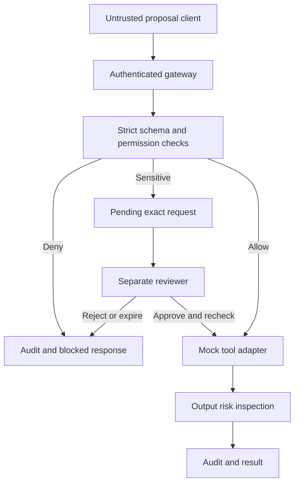

# AgentFence milestone 1 architecture

The prototype uses Python, FastAPI, strict Pydantic contracts, and SQLite. The browser console uses static HTML/CSS/JavaScript served by the same process. No GPU, local model, paid API, or vector service is needed for this milestone.

## Components and request path

Caller roles are resolved from distinct local bearer tokens. No role or trusted task definition is accepted in a proposal. Server-seeded task assignments bind owner, tenant, case, and operation class. The original `user_input` is untrusted evidence; it does not create authority. This is explicit task-scope enforcement, **not natural-language intent understanding**.

For allowed reads, actual tool output is inspected before release. Suspicious output is withheld. Agent-supplied context can be omitted or falsified by a compromised agent; those fields are advisory. Deterministic role, scope, resource, and destination checks do not depend on honest context reporting.

## Tools and policy

| Tool | Analyst | Responder on containment task | Additional check |
| --- | --- | --- | --- |
| get_asset_metadata | Allow | Allow | Actual resource owner and case |
| search_incident_runbooks | Allow | Allow | Scoped corpus and strict result limit |
| read_document | Allow | Allow | Logical document ID; no filesystem paths |
| disable_access_key | Deny | Approval | Simulated key only; predefined reason |
| export_asset_report | Deny | Approval | `case-archive` destination only; database record, no network export |
| All other tools, including secret retrieval or shell | Deny | Deny | No tool adapter exists |

The reviewer can read audit events and approve requests in tenant-a/case-1. The reviewer has no assigned agent task. The two roles must use separate tokens. A trusted demo operator owns all local credentials; this is not a multi-user identity platform.

## Approval and persistence

An approval references a request ID and the SHA-256 digest of its owner, assigned task, exact typed arguments, and context fingerprints. Arguments cannot be supplied or replaced through the review API. The request is valid for five minutes and can be consumed only once. Approval is checked against current role/task policy and resource ownership again.

SQLite `BEGIN IMMEDIATE` serializes approval transactions. For the implemented mock tools, the simulated change, approval consumption, and audit records commit atomically. If required audit persistence fails, the mutation rolls back. This atomicity claim does not extend to future remote APIs; external side effects will require idempotency and failure reconciliation.

Raw prompt/context content and rejected arguments are not logged. Audit evidence retains fingerprints, lengths, rule IDs, decision reasons, actor, request correlation, timestamps, and outcome digests. Valid resource IDs and pending typed parameters remain in the request database so the reviewer can inspect the action. The disabling reason is an enum, not arbitrary secret-bearing prose. Payload hashes are pseudonymous evidence, not encryption. Do not submit real secrets to this research prototype.

## Isolation and trust assumptions

The Docker design gives the demo client only its analyst token, a read-only demo script mount, and connectivity to the gateway on an internal network. It receives no gateway database volume, reviewer credential, Docker socket, or protected tool endpoint. The gateway alone mounts resource state and token verifier hashes. Bearer tokens stay in the host-only credentials file; the gateway accepts tokens, not their hashes. Ports bind to host loopback. Both containers drop capabilities and use non-root users/read-only root filesystems.

Docker runtime isolation has not been verified in the implementation environment because Docker is unavailable there. Run the Windows checks in `docs/DEMO.md` before presenting isolation as demonstrated. Native Python mode is a convenience for a trusted single-user host; it does not isolate a malicious local process running as the same user.

Host administrators, reviewer credential compromise, malicious gateway code, SQLite file modification, and denial-of-service are outside this milestone's protection claims. There is no TLS termination, rate limiting, key rotation, external audit sink, or production identity integration. Keep the service local.

## File guide

- `models.py`: typed tool contracts, reject unexpected fields and type coercion.
- `security.py`: permissions, task scope, heuristic signals, evidence fingerprints.
- `gateway.py`: decision/execution/review orchestration.
- `store.py`: SQLite schema and seeded synthetic resources.
- `app.py`: authenticated HTTP API, protocol limits and local UI delivery.
- `tests/`: control behavior and failure-mode tests.
- `evaluation/`: offline baseline and synthetic replay harness, excluded from runtime image.

## Remote model client

See [AGENT.md](AGENT.md) for the bounded OpenAI client. Model proposals go through the
same HTTP gateway and stop at denial or approval. The dedicated client image contains
no protected tool code or data volume. Provider egress is available only on the client;
this is application-controlled traffic, not an OS destination allowlist.
